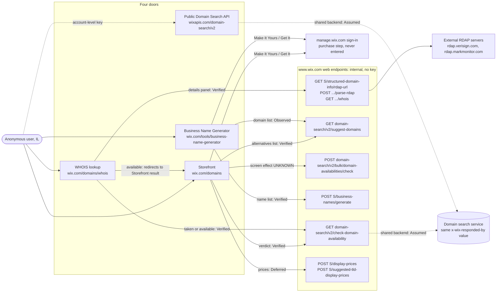

# Architecture: "Can I get this name?"

How the four doors answer the question, which calls each one makes, and what each call drives on the screen.

**Conditions:** 2–3 November 2026, Israel (prices in ₪), desktop Chromium driven by Playwright, anonymous user (no login, clean browser context).

**Evidence levels**
- **Documented:** stated in the Wix API documentation (links at the end).
- **Verified:** proven on 3 November 2026 by response substitution: Playwright replaced the live response and the screen changed accordingly.
- **Observed:** seen in network traffic or on screen; effect on the screen not proven.
- **Assumed:** hypothesis.
- **UNKNOWN:** no evidence.

`W` = `https://www.wix.com`. `S` = `W/_serverless/domains-serverless-services/v1`.

## Diagram

## The doors

### 1. Storefront

Entry `W/domains`, field "Type the domain you want", button "Search Domains", result page `W/domain/result/?q=<input>`.

| Call | Drives on screen | Level |
|---|---|---|
| `GET W/domain-search/v2/check-domain-availability?domain=` | The verdict. `available=false`: "google.com is already registered. Explore some great alternatives below." `available=true`: "Exact Match", "Available now!" and the domain. | Verified: flipping `available` to `true` for `google.com` showed "Available now!" |
| `GET W/domain-search/v2/suggest-domains?query=<input with TLD>&paging.limit=50` | The alternatives list | Verified: one substituted suggestion replaced the 50 real ones |
| `POST W/domain-search/v2/bulk/domain-availabilities/check` (3 batches for a taken name) | UNKNOWN | Observed |
| `POST S/display-prices`, `POST S/suggested-tld-display-prices` | Prices on the tiles | Verified by substitution on 2 November only; not re-checked; Deferred |
| `GET W/_api/user-domains/v1/user_domains/{domain}` | "Is this domain in my account"; 401 `DOMAINS_UNAUTHENTICATED` when anonymous | Observed |
| `GET S/tld-promotions`, `GET S/keywords`, `GET W/domain-search/v2/suggested-tlds`, `GET W/_serverless/premium-domains-serverless/domain-tlds/list-tlds` | UNKNOWN | Observed |

- Input without a TLD produced different call sets on different loads (`bbbbbb` and `banana`: only `suggest-domains`; `agenticqa123`: also `check-domain-availability` for `.com`). Cause UNKNOWN. Observed. Tests therefore always search a full domain and assert what the screen means.
- The web `suggest-domains` call sends the query with its TLD (`query=google.com`); the public contract says the query must not include the TLD. Observed against Documented.
- "Make It Yours" sends a new `check-domain-availability`, then a 302 to a `manage.wix.com` sign-in page. Observed on 3 November during manual exploration; never exercised by tests.

### 2. WHOIS lookup

Entry `W/domains/whois`, field "Enter a domain name or URL", Enter key, result page `W/domain/result/whois?query=<input>`.

| Call | Drives on screen | Level |
|---|---|---|
| `GET W/domain-search/v2/check-domain-availability?domain=` | The branch. `available=true`: client-side redirect to the Storefront result `W/domain/result/?q=` with "Available now!". `available=false`: WHOIS panel. | Verified: flipping `available` to `true` for `google.com` redirected to the Storefront result. The natural redirect for a random free name: Observed. |
| `GET S/structured-domain-info/rdap-url`, then the browser calls external RDAP, then `POST S/structured-domain-info/parse-rdap` (twice), then `GET S/structured-domain-info/whois?domain=&parse=` | Registered-domain details | Chain Observed |
| `POST S/structured-domain-info/parse-rdap` | Created / updated / expiry dates, name servers, status, registrar | Verified: replacing "MarkMonitor Inc." in the response changed the registrar on screen |
| `GET W/v1/domain-broker-offers/query` | UNKNOWN; returned 500 `Failed to extract tenant` anonymously | Observed on 2 November |

- Registrant contact fields show "—": redacted, which is expected.
- The banner reads "is taken. A broker might be able to get it for you." or "is registered" in different sessions. Observed. Tests do not assert banner wording.
- Details arrived after about 15 seconds in one session; a 9-second wait gave a false negative. Observed. Web tests allow 60 seconds.

### 3. Business Name Generator

Entry `W/tools/business-name-generator`, text area "e.g. I own a small catering company…", button "Generate Names", result page `W/domain/result/bng?query=<text>`.

| Call | Drives on screen | Level |
|---|---|---|
| `POST S/business-names/generate` with `{query, excluding, count: 9}` | The 9 names under "Choose a business name". `reasoning` is returned but not shown. | Verified: a substituted first name replaced the real one |
| `GET W/domain-search/v2/suggest-domains?query=<first name>&paging.limit=50` | The domain list with "Get It" buttons | Observed. `paging.limit` was 10 on 2 November and 50 on 3 November; cause UNKNOWN |

- No `check-domain-availability` and no bulk check before a domain is selected. Observed. The Generator's "available" therefore rests only on the documented promise that every suggestion is "available for purchase".
- Re-check of availability at selection: UNKNOWN (not exercised; "Get It" is a buy button).
- Clicking "Generate Names" right after the DOM loaded did nothing once; after the `load` event it worked. Observed. The test waits for `load`.
- Names differ between calls for the same input ("Bakerino", then "Bakerloo"). Expected: suggestions are generated.

### 4. Public Domain Search API

Base `https://www.wixapis.com`. These two GET endpoints are the public contract; the web endpoints above are not.

| Endpoint | Contract | Level |
|---|---|---|
| `GET /domain-search/v2/check-domain-availability` | `domain` required, must include the TLD, 3–63 characters, alphanumeric, hyphens and dots. Response `availability.{domain, available, premium, premiumType}`; `premiumType` enum `FIRST_YEAR_ONLY`, `FIRST_YEAR_AND_RENEWAL`. Error 400 `INVALID_DOMAIN`. | Documented |
| `GET /domain-search/v2/suggest-domains` | `query` required, 1–100 characters, no TLD. `tlds` up to 10, no dot. `paging.limit` max 50; minimum given as both 0 and 1. `paging.cursor`, `maxLength` 3–63. Deprecated `limit` "will be removed on March 1, 2025" and still listed. Response `suggestions[].{domain, premium}`, `pagingMetadata.{count, cursors, hasNext}`. Errors 400 `INVALID_QUERY`, `INVALID_TLD_FORMAT`, `TLD_NOT_SUPPORTED`. A suggestion is "a suggested domain that's available for purchase". | Documented |
| Auth | "Requires an account level API key". The curl examples send only `Authorization: <AUTH>`; the SDK examples pass a `siteId`. Whether `wix-account-id` is required: UNKNOWN. | Documented / UNKNOWN |
| No key, invalid key, real key | 200 with an identical body for `google.com`; the response headers have the same names, and only request IDs and the opaque `x-seen-by` list differ. `suggest-domains` also answers 200 without a key. The key is either not checked or not needed for these calls; which one is UNKNOWN. | Observed on 3 November, 11:39 UTC |
| Errors with the real key | `domain=abc`: 400 `INVALID_DOMAIN` with `fieldViolations` on `domain`. `tlds=.com`: 400 `INVALID_TLD_FORMAT` with `fieldViolations` on `tlds`. Both match the documentation. | Observed on 3 November |

- `paging.limit=100`: 400 with a structured `fieldViolations` entry (`paging.limit`, rule `MAX`, 50). `paging.limit=abc`: 400 "Failed to parse JSON or deserialize protobuf message" without the field name. Observed.
- A non-premium domain returns `premiumType: "UNKNOWN_PREMIUM_TYPE"`, a value outside the documented enum, on both the public API and the web endpoint (`google.com`, `google.biz`, `google.art`, a random free `.com`). Observed. `premium: true` with `UNKNOWN_PREMIUM_TYPE` was seen on 2 November but did not reproduce on the public API on 3 November.
- `suggest-domains?query=artisan bakery&tlds=com&paging.limit=5` returned 4 suggestions, `count: 4`, `hasNext: false`. `paging.limit` is a maximum, so this is within the contract. Observed.

## How the doors relate

- **Storefront and WHOIS share one verdict.** Both call `W/check-domain-availability`, and WHOIS hands every available name to the Storefront result page. A WHOIS "available" is the Storefront "available" by construction. Verified.
- **Storefront and Generator share one list source.** Both lists come from `W/suggest-domains`. Verified for the Storefront, Observed for the Generator.
- **Web endpoints mirror the public paths.** `www.wix.com/domain-search/v2/...` returns the same body shape as `www.wixapis.com/domain-search/v2/...`, and both carry `x-wix-responded-by: wix.premium.domains.v2.availability:CheckDomainAvailability:com.wixpress.premium.domains.domain-search`. Observed. A shared backend is Assumed: a shared service name is not proof.
- **Known differences between web and public.** The web sends the suggest query with a TLD, uses a bulk availability call the public API does not have, and needs no key. Observed.
- **Consequence for testing.** The cheapest cross-door check is to ask the public API about the exact names a web door shows, at the same moment, and compare. That is what the automated web tests do.

## Gaps (UNKNOWN)

- Whether the public API checks the key at all, and the exact header set: it answers identically without one.
- Whether the web endpoints and the public API share a backend.
- How `suggest-domains` decides a domain is available, and what the bulk call drives.
- Whether the Generator re-checks availability at selection.
- Why input without a TLD produces different call sets.
- The checkout URL (never entered by design).
- Behaviour outside Israel.

## Sources

- [About the Domain Search API](https://dev.wix.com/docs/api-reference/account-level/domains/domain-search/introduction)
- [Check Domain Availability](https://dev.wix.com/docs/api-reference/account-level/domains/domain-search/availability-v2/check-domain-availability)
- [Suggest Domains](https://dev.wix.com/docs/api-reference/account-level/domains/domain-search/suggestion-v2/suggest-domains)
- [Domain Search error messages](https://dev.wix.com/docs/api-reference/account-level/domains/domain-search/availability-v2/error-messages)
